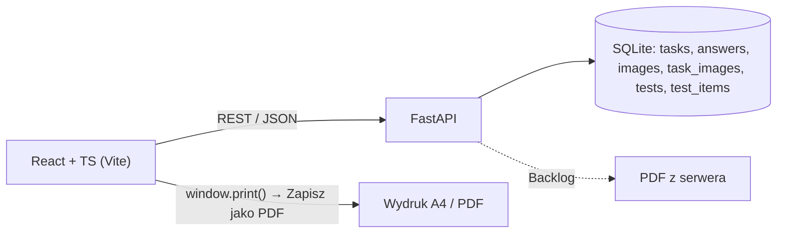
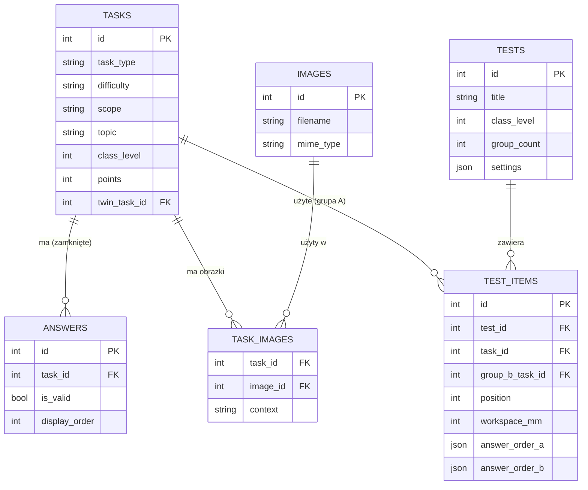

# PRD — Testak: generator sprawdzianów (A4 / PDF)

**Wersja:** 1.2 · **Data:** 2026-11-12 · **Status:** zaakceptowane — gotowe do implementacji (agent: Claude Code, zasady pracy w `CLAUDE.md`)

## Zmiany od v1.1 → v1.2
- **Edycja zadań (FR-48):** każde zadanie z banku można edytować w Testaku (treść, odpowiedzi, metadane) oraz dodać nowe. Edytor treści zadań wychodzi z „Poza zakresem"; FR-47 staje się częścią FR-48. Bank przestaje być „tylko do odczytu": zapis wierszy jest dozwolony, ale wyłącznie przez endpointy edycji zadań; zmiany schematu, migracje i skrypty na tabelach banku pozostają zakazane (`CLAUDE.md`).
- **Jeden użytkownik, bez logowania** — potwierdzone, bez zmian (sekcja 3, D-Login).
- **Wygląd i układ ekranów:** `DESIGN.md` (styl „Tablica szkolna", ekrany, zachowanie na laptopie/tablecie/telefonie).

## Zmiany od v1.0 → v1.1
- **Bliźniaki poza losowaniem (FR-5a):** zadanie wskazywane przez cudze `twin_task_id` nie wchodzi do puli kandydatów; przy 2 grupach trafia do grupy B. Bramka przed implementacją: sprawdzić, czy `twin_task_id` jest symetryczny.
- **Zamrożenie grup A/B (FR-19, D8):** warianty są generowane przy tworzeniu pozycji / włączeniu 2 grup i trzymane w stanie (undo je obejmuje), a nie „przy zapisie" — to usuwa konflikt z autozapisem (FR-41). FR-22: autozapis nie czyści historii undo.
- **`is_valid` w API:** zniesiony zakaz zwracania go w API (aplikacja jednoosobowa); arkusz ucznia go nie renderuje (sekcja 9).
- **Kolejność w potoku HTML (FR-4):** najpierw podmiana `image://`, potem DOMPurify (inaczej obrazki znikają).
- **Liczniki i filtry (FR-3):** zadania z pustą wartością liczą się w każdym koszyku; tematy per klasa.
- **Wyszukiwanie (FR-2):** funkcja casefold zamiast `LIKE`/`lower()` (SQLite obsługuje wielkość liter tylko dla ASCII — polskie znaki).
- **Przycisk „Dopasuj wysokość" (FR-26 → Must):** równo rozdziela wolne miejsce strony między zadania otwarte.
- **S → Must:** FR-10 (limity globalne), FR-11 (wykluczanie użytych zadań), FR-16 (podsumowanie na żywo) i FR-32 (numeracja stron) wchodzą do MVP.
- **Alembic (sekcja 7):** jedna `Base` + `include_object` pomijający tabele banku.
- **Paginacja i druk (D2, sekcja 9, Faza 3):** czysta funkcja z testami Vitest; wczesny spike druku.
- **Stan reducera (D3):** pola grup od Fazy 2, żeby Faza 6 nie wymagała refaktoru.
- **Higiena repo (5.1, Faza 0):** kopia `tasks.db`, absolutna ścieżka do bazy, uzupełnienie `requirements.txt`.
- Zasady pracy agenta i skrót decyzji: `CLAUDE.md` (spójny z tym PRD; w razie rozbieżności wygrywa `CLAUDE.md`).

## Zmiany od v0.2 → v1.0
- Potwierdzone: puste `scope` traktowane tak samo jak puste `difficulty` (zawsze pasuje do dowolnego filtra zakresu).
- Doprecyzowany wydruk 2 grup: **wymuszony podział strony między grupami** — grupa B zawsze zaczyna nową stronę, nawet jeśli strona grupy A nie jest w pełni zapełniona (każda osoba z ławki dostaje osobny, fizycznie oddzielny komplet kartek).
- Potwierdzone: maks. 2 grupy.
- `task_images.context` wyjaśnione na realnym przykładzie: `question` / `answer_A` / `answer_B` / `answer_C` / `answer_D`. Przy okazji potwierdziło się, że niektóre odpowiedzi zamknięte to same obrazki SVG.
- Dodany mały, opcjonalny punkt backlogowy: uzupełnianie metadanych niekompletnych zadań wprost w Testaku.
- Sekcja 13 zamknięta — zostały tylko drobne, nieblokujące założenia.

## Zmiany od v0.1
- Przedmiot w MVP: tylko matematyka, z architekturą gotową na inne przedmioty później.
- Losowanie: doszły kryteria `class_level`, `topic`, `scope`, wielowartościowy `difficulty` + reguła, że zadania bez podanej trudności zawsze pasują.
- Nowa funkcja: test na 2 grupy (A/B) — podmiana na zadanie bliźniacze albo przetasowanie odpowiedzi.
- Klucz odpowiedzi (dla zadań zamkniętych) przeniesiony do MVP.
- Doszły: zapis testu do pliku `.json` (eksport/import) i cofanie zmian (undo/redo).
- PDF doprecyzowany: w MVP wystarcza druk z przeglądarki → „Zapisz jako PDF" (zero dodatkowej pracy backendowej).
- Model danych zaktualizowany o realny schemat z przesłanego eksportu bazy (`answers`, `task_images`, pełna `tasks`).

## 1. Streszczenie

Testak to aplikacja webowa dla nauczyciela. Z istniejącego banku zadań (obecnie: matematyka) składa sprawdzian — ręcznie albo losowaniem wg kryteriów (klasa, zakres materiału, poziom, trudność, typ). Pozwala swobodnie ustawić miejsce na rozwiązania pod każdym zadaniem, umie przygotować dwie wersje testu (grupa A/B) i drukuje arkusz na A4 — łącznie z zapisem do PDF — dokładnie tak, jak wygląda na ekranie.



## 2. Problem i cele

**Problem.** Ręczne składanie sprawdzianu (kopiuj-wklej do edytora tekstu) jest wolne. Trudno kontrolować, ile miejsca zostaje na rozwiązanie, jak przygotować dwie różne wersje tego samego testu i jak zadania rozkładają się na stronach.

**Cele (mierzalne)**
- **G1** — sprawdzian z 5 zadań z losowania w mniej niż 2 minuty.
- **G2** — wydruk = podgląd: te same podziały stron, miejsce robocze z dokładnością ±1 mm.
- **G3** — pełna kontrola miejsca roboczego przy każdym zadaniu (w mm, suwakiem).
- **G4** — losowanie przewidywalne: albo spełnia kryteria, albo jasno mówi, czego brakuje.
- **G5** — test na 2 grupy ma dawać uczniom realnie różne (albo przynajmniej przetasowane) zestawy, gotowe do wydrukowania bez ręcznej poprawki.

## 3. Użytkownik i scenariusz

- **Użytkownik główny:** nauczyciel lub korepetytor. **MVP: tylko matematyka** — pole `subject` zostaje jednak zwykłym polem (nie hardkodowanym), więc dojście kolejnych przedmiotów to w przyszłości kwestia danych, nie przebudowy.
- **Uczeń** nie korzysta z aplikacji — dostaje wydruk/PDF.
- **Założenie MVP:** jeden użytkownik, lokalnie, bez logowania (patrz sekcja 10, D-Login niżej — dodanie logowania później nie jest dużym ryzykiem, jeśli trzymamy się kilku zasad).

**Scenariusz główny**
1. Wybieram klasę (`class_level`) i tytuł testu; decyduję, czy to test na 1 czy 2 grupy.
2. Ustawiam kryteria (np. 3 zamknięte + 2 otwarte, zakres materiału, poziom, trudność) i klikam „Losuj".
3. Poprawiam skład: przelosowuję jedno zadanie, przypinam dobre, dodaję ręcznie. W razie pomyłki — cofam (Ctrl+Z).
4. Ustawiam miejsce robocze przy zadaniach (suwak, mm).
5. Jeśli 2 grupy: aplikacja sama dobiera wersję B (bliźniak albo przetasowane odpowiedzi) — mogę to podejrzeć.
6. Sprawdzam podgląd A4 → drukuję i/lub zapisuję do PDF (na pendrive) oraz zapisuję test (baza + eksport do pliku).

## 4. Zakres

✅ **MVP**
- bank zadań z filtrami i wyszukiwaniem
- losowanie wg kryteriów: typ, trudność (z regułą „brak = zawsze pasuje"), klasa, zakres materiału, poziom
- ręczna kompozycja (dodaj, usuń, zmień kolejność)
- **cofanie/przywracanie zmian (undo/redo)**
- podgląd A4 w skali 1:1 z paginacją
- regulacja miejsca roboczego per zadanie (suwak, pole w kratkę) + przycisk „Dopasuj wysokość" (FR-26)
- druk z przeglądarki **+ zapis do PDF** (okno druku → „Zapisz jako PDF")
- **test na 2 grupy (A/B)** z podmianą na zadanie bliźniacze lub przetasowaniem odpowiedzi
- **klucz odpowiedzi dla zadań zamkniętych** (osobny widok/wydruk, poprawny per grupa)
- limity globalne losowania, wykluczanie zadań z wcześniejszych testów, podsumowanie punktów i czasu na żywo, numeracja stron (FR-10, FR-11, FR-16, FR-32)
- zapis testu w bazie **+ eksport/import do pliku `.json`**

🔜 **Później:** edycja i dodawanie zadań w Testaku (FR-48), PDF generowany po stronie serwera (jeden klik, bez okna druku), więcej niż 2 grupy, inne przedmioty niż matematyka, historia użycia zadań, eksport DOCX, przetasowanie odpowiedzi też w trybie 1 grupy (utrudnianie ściągania)

❌ **Poza zakresem:** rozwiązywanie testów online, automatyczne ocenianie, masowy import zadań w UI, konta wielu nauczycieli, generowanie zadań przez AI, edycja na telefonie

## 5. Stan wyjściowy (as-is)

### 5.1 Kod
- **Backend** (FastAPI + SQLAlchemy + SQLite): `GET /tasks/` (limit 50, bez filtrów i paginacji) oraz `GET /images/{filename}`.
- **Model `Task`** w `backend/models.py` jest dziś **węższy niż realna baza** — brakuje w nim `external_id`, `date_created`, `updated_at`, a także całych tabel `answers` i `task_images` (patrz 5.2). To pierwsza rzecz do ogarnięcia w Fazie 0.
- **Frontend** (React 19 + TypeScript + Vite + Tailwind 4): lista zadań po lewej, pusty arkusz A4 po prawej; `image://…` w HTML jest podmieniane na `/images/…`.
- **Baza i środowisko:** `backend/tasks.db` jest w `.gitignore` i jest jedyną kopią banku — przed pracą zrób kopię. Ścieżka w `database.py` jest względna (`./tasks.db`) i zależy od katalogu uruchomienia (zły katalog = po cichu pusta baza) → zamienić na absolutną. `requirements.txt` jest niepełny (brak `pytest`, `httpx`, `alembic`).

### 5.2 Realny schemat bazy (z przesłanego eksportu)

**`tasks`** — kolumny: `id`, `external_id`, `date_created`, `subject` (NOT NULL), `class_level`, `difficulty`, `task_type` (NOT NULL), `scope`, `topic`, `points`, `time_minutes`, `source`, `content_html` (NOT NULL), `content_text`, `twin_task_id` (FK do `tasks.id`), `created_at` (NOT NULL), `updated_at` (NOT NULL). Poza `subject`, `task_type`, `content_html`, `created_at`, `updated_at` — **wszystko inne jest nullable**, co pokrywa się z Twoją uwagą o niepełnych zadaniach dodanych przez nauczycieli. **Doprecyzowane:** `external_id`, `date_created` i `updated_at` pochodzą z bazy źródłowej, z której zaimportowano zadania — `external_id` zostaje świadomie jako odniesienie do tamtej bazy (widzieliśmy to w nazwie pliku obrazka `47a.svg`, gdzie „47" to `external_id`), a `date_created`/`updated_at` niosą metadane z importu, na razie nieistotne dla MVP. `updated_at` wróci jednak jako temat przy FR-47 (edycja metadanych) — trzeba będzie zdecydować, czy nasza edycja go nadpisuje, czy dostaje osobną kolumnę. `created_at` to najpewniej moment wstawienia wiersza do naszej własnej bazy.

**`answers`** (NOWOŚĆ względem v0.1) — opcje odpowiedzi dla zadań zamkniętych: `id`, `task_id` (FK, CASCADE), `answer_label`, `content_html` (NOT NULL), `content_text`, `is_valid` (BOOLEAN, domyślnie 1 — czy to POPRAWNA odpowiedź), `display_order`. To dokładnie to, czego brakowało w v0.1 do klucza odpowiedzi.

**`images`** — jak wcześniej, plus `filename` UNIQUE i `created_at`.

**`task_images`** — tabela łącząca: `task_id`, `image_id`, `context`, PK złożony z trzech kolumn. **`context` wyjaśnione** na przesłanej próbce danych — wartości to `question` (obrazek w treści pytania) oraz `answer_A` / `answer_B` / `answer_C` / `answer_D` (obrazek w konkretnej odpowiedzi zamkniętej; dopasowanie po `answers.answer_label`, nie po osobnym FK do `answers.id`). Przy tej samej próbce potwierdziło się, że **niektóre odpowiedzi zamknięte to same obrazki SVG** (np. zapis przedziału liczbowego w nawiasach, którego nie da się dobrze złożyć w czystym HTML) — więc `answers.content_html` najpewniej zawiera `image://…` dokładnie tak jak `tasks.content_html`, i powinno przejść przez ten sam mechanizm podmiany URL-i (do potwierdzenia na realnym wierszu `answers`, patrz sekcja 13). `task_images` samo w sobie traktuję jako metadane pomocnicze do zarządzania/sprzątania obrazków — renderowanie nadal opiera się o `image://` w HTML.

**Indeksy:** `class_level`, `external_id`, `task_type` na `tasks`; `task_id` na `answers`; `filename` na `images`.

### 5.3 Rzeczywiste wartości w danych (z Twojego eksportu DISTINCT)

To jest teraz twarda podstawa pod reguły losowania, nie zgadywanie:

| Pole | Wartości | Uwagi |
|---|---|---|
| `task_type` | `otwarte` (3943 zadań), `zamknięte` (1100 zadań) | zgodnie z Twoim zapytaniem do bazy |
| `difficulty` | *(puste)*, `łatwe`, `średnie`, `trudne` | puste = zawsze pasuje do każdego filtra trudności |
| `scope` | *(puste)*, `podstawowy`, `rozszerzony` | to jest „poziom" z Twojej wiadomości |
| `class_level` | 1, 2, 3, 4 | zgodne z 4-letnim liceum; pole zostaje zwykłym INT, nic nie blokuje wyższych wartości w przyszłości |
| `topic` | 28 różnych wartości | różne per klasa (np. kl. 1: „Funkcje i ich własności", „Trygonometria kąta ostrego"…; kl. 4: „Rachunek prawdopodobieństwa", „Elementy statystyki"…) |

**Obserwacja (do weryfikacji, nie pewnik):** w analizowanym eksporcie *wszystkie* kombinacje z pustym `difficulty` miały też `points = 0`, czyli zadania bez trudności wyglądają na niekompletne wpisy (brakuje im też punktacji), nie tylko brakuje im trudności. Warto to uwzględnić przy regule „suma punktów" w kryteriach losowania (FR-14) — zadanie z `points = 0` sztucznie nie wnosi nic do sumy, mimo że liczy się jako „jedno zadanie".

## 6. Wymagania funkcjonalne

Priorytety: **M** = Must (MVP) · **S** = Should · **C** = Could

### 6.1 Bank zadań
- **FR-1 · M** — Lista z paginacją (`limit`/`offset`) i filtrami: `class_level`, `difficulty`, `task_type`, `scope`, `topic`, `source`. Filtr przyjmuje wiele wartości (np. kilka `topic` albo kilka `difficulty`).
- **FR-2 · M** — Wyszukiwanie tekstowe po `content_text`. Wielkość liter bez znaczenia także dla polskich znaków: `LIKE`/`lower()` w SQLite działają tylko dla ASCII, więc używamy własnej funkcji casefold zarejestrowanej w silniku; znaki `%` i `_` w zapytaniu są escapowane.
- **FR-3 · S** — Liczniki przy filtrach („zamknięte (1100)"), potrzebne też do losowania. Zadania z pustym `difficulty`/`scope` liczą się w każdym koszyku (zgodnie z FR-7/7a), więc suma liczników może przekraczać liczbę zadań — to zamierzone. Facety przyjmują `class_level`; lista tematów jest per klasa.
- **FR-4 · M** — Podgląd zadania z poprawnie wyrenderowanym HTML, obrazkami i — dla zamkniętych — listą odpowiedzi z `answers`. Podmiana `image://…` na `/images/…` działa identycznie na `content_html` zadania i na `content_html` każdej odpowiedzi — niektóre odpowiedzi to same obrazki. Kolejność: najpierw podmiana `image://` → `/images/`, dopiero potem sanityzacja (DOMPurify odrzuca nieznane schematy URI). `is_valid` jest zwracane przez API (jeden schemat odpowiedzi); komponenty arkusza go nie renderują.

### 6.2 Losowanie wg kryteriów

**Reguła** = filtry + liczba zadań (np. `task_type=zamknięte`, `scope=podstawowy`, `count=3`). **Kryteria** = lista reguł. `class_level` ustawiasz raz dla całego testu (nie per reguła) — sprawdzian pisze się dla jednej klasy.

- **FR-5 · M** — Losowanie bez powtórzeń wg listy reguł. Wynik trafia do testu jako propozycja, którą można poprawiać.
- **FR-5a · M** — **Bliźniaki nie biorą udziału w losowaniu:** wiersz wskazywany przez `twin_task_id` innego zadania jest wykluczony z puli kandydatów (to wariant innego zadania). Przy `group_count = 2` taki bliźniak trafia do grupy B (6.3a). Ręczne dodanie bliźniaka z banku jest dozwolone (założenie do potwierdzenia). **Bramka:** przed implementacją sprawdź zapytaniem, czy `twin_task_id` jest symetryczny (X→Y i Y→X); jeśli tak, ustal, która strona jest „oryginałem" — inaczej reguła wykluczyłaby obie strony pary.
- **FR-6 · M** — **Trudność w regule to lista** (np. `["łatwe", "średnie"]` = dowolne z tych dwóch), nie pojedyncza wartość. Pusta lista = dowolna trudność.
- **FR-7 · M** — **Zadanie z pustym `difficulty` zawsze pasuje do filtra trudności**, niezależnie od tego, co reguła wybiera — nie znamy jego poziomu, więc nie wykluczamy go z puli.
- **FR-7a · M** — **Potwierdzone: ta sama zasada dotyczy `scope`** — zadanie z pustym `scope` zawsze pasuje do filtra zakresu (podstawowy/rozszerzony).
- **FR-8 · M** — Gdy kandydatów jest mniej niż `count`: komunikat „Reguła 2: potrzeba 5, dostępnych 4" + wybór „weź 4" / „zmień kryteria".
- **FR-9 · M** — „Przelosuj" pojedyncze zadanie (z tej samej reguły) oraz „Przypnij" — przypięte zadanie zostaje przy „Przelosuj wszystko".
- **FR-10 · M** — Limity globalne: suma punktów (± tolerancja — z zastrzeżeniem o zadaniach z `points=0`, patrz 5.3), maksymalny czas, maksymalnie N zadań z jednego `topic`. Realizacja: losowanie z odrzucaniem (do N prób, powtarzalne przy `seed`); gdy limitu nie da się spełnić — najbliższy wynik + ostrzeżenie (jak w FR-8).
- **FR-11 · M** — Wykluczenie zadań użytych we wskazanych wcześniejszych testach. Zbiór wykluczeń obejmuje `task_id` i `group_b_task_id` z wybranych testów (wymaga zapisanych testów — Faza 5) i trafia do `exclude_task_ids`.
- **FR-12 · C** — `seed`: powtarzalny wynik (ułatwia też testy automatyczne).

**Dopasowanie trudności i zakresu — dokładna reguła (FR-6/FR-7/FR-7a):**
```python
def matches_filter(task_value: str | None, wanted: list[str]) -> bool:
    if not wanted:                          # reguła nie filtruje po tym polu
        return True
    if not task_value:                      # zadanie bez podanej wartości (NULL albo "")
        return True                         # zawsze pasuje — nie znamy jej
    return task_value in wanted
```
Tej samej funkcji używasz dwa razy: raz dla `difficulty`, raz dla `scope` — zero kopiowania logiki. To dobry kawałek kodu do zrozumienia na starcie — krótkie, ale pokazuje świadome traktowanie brakujących danych zamiast ich ignorowania.

**Algorytm (MVP)**
1. Dla każdej reguły pobierz same `id` kandydatów (bez HTML, BLOB-ów i bez `answers`), stosując powyższe dopasowanie trudności.
2. Posortuj reguły od najbardziej restrykcyjnej (najmniej kandydatów).
3. Dla każdej reguły: `random.sample` z kandydatów pomniejszonych o już wybrane.
4. Niedobór → wynik częściowy + ostrzeżenie (FR-8).
5. Zwróć zadania w kolejności reguł.

**Przykład `POST /draws`:**
```json
{
  "class_level": 2,
  "rules": [
    {"task_type": "zamknięte", "scope": ["podstawowy"], "difficulty": ["łatwe", "średnie"], "topics": ["Funkcja kwadratowa"], "count": 3},
    {"task_type": "otwarte", "scope": ["podstawowy"], "difficulty": [], "topics": [], "count": 2}
  ],
  "exclude_task_ids": [],
  "seed": null
}
```

**Kryteria akceptacji**
- Jeśli w bazie jest ≥ 3 zamkniętych i ≥ 2 otwartych pasujących do filtrów (klasa 2, zakres podstawowy) i losuję „3 zamknięte + 2 otwarte", to dostaję dokładnie 5 różnych zadań.
- Jeśli zadanie ma `difficulty = NULL` i reguła filtruje `difficulty = ["trudne"]`, to to zadanie i tak jest w puli kandydatów.
- Jeśli zadanie jest bliźniakiem innego (wskazuje na nie `twin_task_id`), to nigdy nie trafia do wyniku losowania.
- Jeśli ten sam `seed` i ta sama baza, to wynik jest identyczny.
- Jeśli zadanie jest przypięte i wybieram „Przelosuj wszystko", to zadanie zostaje — a jeśli zapomnę przypiąć i tak klikam, **cofnięcie (Ctrl+Z) przywraca poprzedni skład** (patrz 6.3b).

### 6.3 Kompozycja testu
- **FR-13 · M** — Dodawanie ręczne z banku, usuwanie, zmiana kolejności (przeciąganie + klawiatura), automatyczna numeracja.
- **FR-14 · M** — Nagłówek arkusza: tytuł, klasa, data oraz pola „Imię i nazwisko" i „Grupa".
- **FR-15 · M** — Wybór liczby grup testu: **1 albo 2**. Przy 2 grupach aplikacja sama dobiera wersję B dla każdego zadania (patrz 6.3a).
- **FR-16 · M** — Podsumowanie na żywo: suma punktów (z adnotacją, jeśli któreś zadanie ma `points = 0`) i szacowany czas. Przy 2 grupach osobno dla A i B (bliźniak może mieć inne `points`/`time_minutes`).

#### 6.3a Grupy A/B (nowość w v0.2)

Dokładnie reguła, którą opisałeś:

| Sytuacja | Grupa A | Grupa B |
|---|---|---|
| zadanie ma `twin_task_id` | oryginalne zadanie | zadanie spod `twin_task_id` (inna treść) |
| brak `twin_task_id`, `task_type = otwarte` | zadanie X | to samo zadanie X, bez zmian |
| brak `twin_task_id`, `task_type = zamknięte` | zadanie X, odpowiedzi w kolejności losowej #1 | to samo zadanie X, odpowiedzi w kolejności losowej #2 (niezależnie wylosowanej) |

- **FR-17 · M** — Reguła z tabeli wyżej stosowana automatycznie przy generowaniu/przelosowywaniu zadania w teście 2-grupowym.
- **FR-18 · M** — Dla zadań zamkniętych kolejność odpowiedzi (A/B/C/D) jest losowana **niezależnie dla każdej grupy** — również wtedy, gdy obie grupy mają inne zadanie (bliźniacze): wersja A ma swoją losową kolejność, wersja B swoją.
- **FR-19 · M** — Wybrana kolejność odpowiedzi i przypisanie bliźniaka są generowane **w momencie utworzenia pozycji lub włączenia 2 grup**, trzymane w stanie reducera (objęte undo/redo) i zapisywane bez zmian — także przez autozapis. Nie losują się na nowo przy podglądzie, wydruku ani zapisie, bo inaczej klucz odpowiedzi przestałby się zgadzać z wydrukiem. Osobna akcja „przelosuj warianty grup" pozwala to świadomie zmienić.
- **FR-20 · S** — Podgląd pozwala przełączać się między „Grupa A" / „Grupa B", żeby zobaczyć obie wersje przed drukiem.

**Kryterium akceptacji**
- Jeśli zadanie zamknięte nie ma bliźniaka, to na wydruku grupy A i grupy B widać tę samą treść pytania, ale inną kolejność odpowiedzi — i klucz odpowiedzi poprawnie wskazuje inną literę dla każdej grupy.

#### 6.3b Cofanie zmian — undo/redo (nowość w v0.2)

- **FR-21 · M** — Ctrl+Z / Ctrl+Y (albo przyciski) cofają i przywracają: dodanie/usunięcie zadania, zmianę kolejności, przelosowanie (pojedyncze i „wszystko"), zmianę przypięcia, zmianę miejsca roboczego. Cofalne są też wygenerowane warianty grup A/B (D8).
- **FR-22 · S** — Historia utrzymywana w pamięci przeglądarki (nie w bazie) do zamknięcia karty lub otwarcia innego testu; autozapis (FR-41) jej nie czyści. Nie musi przetrwać odświeżenia strony w MVP.

**Kryterium akceptacji**
- Klikam „Przelosuj wszystko" bez przypięcia zadania, którego chciałem nie stracić → Ctrl+Z przywraca dokładnie poprzedni skład testu.

### 6.4 Miejsce robocze
- **FR-23 · M** — Każde zadanie ma własną wysokość miejsca roboczego w **mm** (0–250), ustawianą **suwakiem** (`<input type="range">`) + polem liczbowym do wpisania dokładnej wartości.
- **FR-24 · M** — Pole robocze domyślnie **w kratkę** (siatka ~5 mm) — zgodnie z tym, jak ma wyglądać u Ciebie. Warianty „puste" / „linie" zostają jako dodatkowa opcja stylu, bo kosztują tylko CSS.
- **FR-25 · S** — Wartości domyślne wg `task_type` (np. zamknięte 15 mm, otwarte 60 mm) oraz akcja „ustaw wszystkim X mm".
- **FR-26 · M** — Przycisk „Dopasuj wysokość": dla każdej strony wolne miejsce (wysokość strony minus suma wysokości zadań wraz z ich miejscem roboczym) dzielone jest **po równo między zadania otwarte na tej stronie**. Zadania zamknięte zachowują swoją wartość; wynik zaokrąglany w dół do pełnych mm i ograniczany do 0–250; dotyczy też ostatniej strony; nie zmienia podziałów stron; strony bez zadań otwartych zostają bez zmian. Przy 2 grupach dla każdej pozycji brany jest mniejszy wynik z grupy A i B (miejsce robocze jest wspólne). Jedna akcja = jeden krok undo.
- **FR-27 · C** — Wskaźnik „na tej stronie zostało X mm".

**Kryteria akceptacji**
- Jeśli miejsce robocze wynosi 50 mm, to na wydruku zmierzone linijką ma 50 mm ± 1 mm.
- Jeśli przesuwam suwak, to podgląd i podziały stron przeliczają się od razu, bez przeładowania.
- Jeśli klikam „Dopasuj wysokość", to na każdej stronie z zadaniami otwartymi mają one równe miejsce robocze, zadania zamknięte i podziały stron się nie zmieniają, a jedno Ctrl+Z przywraca poprzednie wartości.

### 6.5 Podgląd A4 i druk
- **FR-28 · M** — Podgląd 1:1 w mm (210 × 297) z widocznymi stronami i marginesami (domyślnie 15 mm, minimum 10 mm).
- **FR-29 · M** — Paginacja: zadanie razem z miejscem roboczym nie jest dzielone między strony (wyjątek: zadanie wyższe niż strona → ostrzeżenie). Możliwość ręcznego „wymuś nową stronę".
- **FR-30 · M** — Druk z przeglądarki: tylko arkusz (interfejs ukryty), A4 pionowo, skala 100%. **Wybranie w oknie druku „Zapisz jako PDF" daje gotowy plik PDF — to pokrywa wymóg „PDF na pendrive" bez żadnej dodatkowej pracy po stronie serwera.**
- **FR-31 · M** — **Potwierdzone:** dla testu na 2 grupy jeden plik/wydruk obejmuje obie grupy po kolei (najpierw wszystkie strony grupy A, potem grupy B), ale **grupa B zawsze zaczyna się od nowej, pustej strony** — nawet jeśli ostatnia strona grupy A ma wolne miejsce. Przykład: sprawdzian na 1,5 strony wydrukowany dla 2 grup to **4 strony** (2 na grupę A, z pustym miejscem na dole drugiej; 2 na grupę B), nie 3. Powód: każda osoba przy wspólnej ławce dostaje osobny, fizycznie oddzielny komplet kartek — nie można dzielić jednej kartki między dwie grupy.
- **FR-32 · M** — Numer strony „x / y" i stopka (np. `source`). Numeracja od 1 osobno dla każdej grupy (każda grupa to osobny komplet kartek); stopka ze `source` jako opcja w ustawieniach arkusza, domyślnie wyłączona (założenie do potwierdzenia — prawa do treści, sekcja 12).
- **FR-33 · C** — PDF generowany na serwerze — **świadomie zepchnięty do backlogu** (patrz D1 w sekcji 10): sensowny dopiero przy hostingu współdzielonym, gdzie nie każdy ma wygodne okno druku.
- **FR-34 · C** — Tryb oszczędny (mniejsza czcionka, bez kratki).

**Kryterium akceptacji**
- Jeśli test ma 3 strony, to wydruk/PDF z Chrome i Edge ma tę samą liczbę stron i te same miejsca podziałów co podgląd.
- Test na 1,5 strony wydrukowany dla 2 grup ma dokładnie 4 strony — strona 3 (pierwsza strona grupy B) zaczyna się od pierwszego zadania, nie od połowy poprzedniej strony.

### 6.6 Klucz odpowiedzi (nowość w v0.2, przeniesione do MVP)
- **FR-35 · M** — Osobny widok/wydruk: dla każdego zadania zamkniętego pokazuje, która litera (A/B/C/D) jest poprawna — **per grupa**, bo kolejność odpowiedzi różni się między grupami (patrz 6.3a).
- **FR-36 · M** — Klucz nigdy nie pojawia się na arkuszu dla ucznia — to osobny dokument/widok wyłącznie dla nauczyciela.
- **FR-37 · C** — W kluczu też punktacja per zadanie, do szybkiego sprawdzenia maks. liczby punktów.

**Algorytm:** dla zadania zamkniętego w danej grupie znajdź odpowiedź z `is_valid = 1`, znajdź jej pozycję w zamrożonej kolejności tej grupy (`answer_order_a`/`answer_order_b`), zamień pozycję (0,1,2,3) na literę (A,B,C,D).

### 6.7 Zapis testów
- **FR-38 · M** — Zapisz / otwórz / duplikuj / usuń test w bazie (lista testów z tytułem i datą).
- **FR-39 · M** — **Eksport testu do pliku `.json`** — zawiera kolejność zadań, miejsce robocze per zadanie, liczbę grup, przypisanie bliźniaków i zamrożoną kolejność odpowiedzi per grupa. Plik można przenieść na inny komputer.
- **FR-40 · M** — **Import testu z pliku `.json`** z powrotem do aplikacji, gotowy do dalszej edycji.
- **FR-41 · S** — Autozapis do bazy (debounce ok. 1 s).

### 6.8 Później (backlog)
- **FR-42** — PDF z serwera (jeden klik, bez okna druku) — patrz D1.
- **FR-43** — Więcej niż 2 grupy.
- **FR-44** — Inne przedmioty niż matematyka (dane + UI).
- **FR-45** — Historia użycia zadań (kiedy i ile razy użyte).
- **FR-46** — Przetasowanie odpowiedzi też w trybie 1 grupy (utrudnianie ściągania między sąsiadami).
- **FR-47** — Uzupełnianie metadanych niekompletnych zadań (temat, poziom, trudność, punkty) wprost w Testaku — mały formularz ograniczony do pól taksonomii, bez edytora treści zadania. Najtańsza wersja: `PATCH /tasks/{id}` tylko na tych polach. Dobry kandydat na pierwsze rozszerzenie po MVP, bo wprost poprawia jakość puli do losowania. **Od v1.2 część FR-48** (może być jego pierwszym etapem).
- **FR-48** — **Edycja i dodawanie zadań w Testaku.** Każde zadanie z banku ma akcję „Edytuj": metadane (klasa, dział, temat, typ, zakres, trudność, punkty, czas), treść (`content_html` — edytor z symbolami matematycznymi) i odpowiedzi (treść, kolejność, która jest poprawna). Ten sam formularz służy do dodania nowego zadania. `content_text` jest przeliczane z treści przy zapisie (wyszukiwanie FR-2). Układ ekranu: `DESIGN.md` 5.3–5.4. Do rozstrzygnięcia przed implementacją: (a) zapis w miejscu czy w osobnej tabeli zmian, (b) czy edycja nadpisuje `updated_at`, (c) usuwanie zadania użytego w zapisanym teście, (d) edycja zadania mającego bliźniaka, (e) biblioteka edytora i zapis wzorów. Warunek startu: świeża kopia `tasks.db`.

## 7. Model danych (propozycja)

`tasks`, `answers`, `images`, `task_images` to bank — zapis wierszy **wyłącznie przez dedykowane endpointy edycji zadań** (FR-48), nigdy przez migracje ani skrypty; schemat bez zmian, jak w 5.2. Dochodzą dwie własne tabele:

- **`tests`** — `id`, `title`, `subject`, `class_level`, `group_count` (1 lub 2, `CHECK`), `settings` (JSON: marginesy, czcionka, pola nagłówka), `created_at`, `updated_at`
- **`test_items`** — `id`, `test_id` → `tests`, `position`, `task_id` → `tasks` (treść dla grupy A / jedyna treść przy 1 grupie), `group_b_task_id` → `tasks` (NULL, wypełnione tylko gdy jest bliźniak i `group_count = 2`), `workspace_mm`, `workspace_style`, `page_break_before`, `locked`, `answer_order_a` (JSON: lista `answer_id` w kolejności — tylko dla zamkniętych), `answer_order_b` (jw., tylko przy 2 grupach)



**Decyzje**
- Kolejność zadań to kolumna `position` (unikalna w obrębie testu).
- `settings`, `answer_order_a/b` jako JSON — elastyczne, bez dodatkowych tabel dla czegoś, co zawsze czytamy/piszemy w całości.
- Zmiany schematu przez migracje Alembic, a nie `create_all`. Jedna `Base`; `env.py` z `include_object` pomija tabele banku (`tasks`, `answers`, `images`, `task_images`), `render_as_batch=True` (SQLite). Nigdy autogenerate względem tabel banku.
- Test trzyma tylko `task_id`/`group_b_task_id` — jeśli bank się zmieni, stare testy zmienią treść (ryzyko w sekcji 12).
- `group_b_task_id` jako pojedyncza kolumna (nie osobna tabela grup) to świadome uproszczenie pod potwierdzony limit **maks. 2 grupy** (FR-43 w backlogu, gdyby to się kiedyś zmieniło).

## 8. API (propozycja, REST/JSON)

| Metoda | Ścieżka | Opis |
|---|---|---|
| GET | `/tasks` | filtry (w tym `difficulty[]`, `scope[]`, `topic[]`), paginacja, `q` |
| GET | `/tasks/facets` | wartości filtrów z licznikami |
| GET | `/tasks/{id}` | jedno zadanie z odpowiedziami (`answers`) |
| POST | `/draws` | losowanie wg reguł (nic nie zapisuje) |
| GET, POST | `/tests` | lista / utworzenie |
| GET, PUT, DELETE | `/tests/{id}` | odczyt / zapis / usunięcie |
| POST | `/tests/{id}/duplicate` | kopia testu |
| GET | `/tests/{id}/export` | pobranie `.json` (ten sam payload co GET, jako plik do pobrania) |
| POST | `/tests/import` | wczytanie testu z przesłanego `.json` |
| GET | `/tests/{id}/answer-key` | klucz odpowiedzi, per grupa |
| GET | `/images/{filename}` | już jest; dodać cache (`ETag`) |
| GET | `/tests/{id}/pdf` | backlog (FR-42) |

**Zasady**
- `/tasks/facets` zadeklaruj **przed** `/tasks/{id}` — inaczej FastAPI potraktuje „facets" jako `id` i zwróci 422.
- Losowanie jest osobnym, „czystym" krokiem (nie zapisuje) — łatwo je testować i ponawiać.
- Lista zadań zwraca `{items, total}`.

## 9. Wymagania niefunkcjonalne

- **Wydajność:** filtrowanie i losowanie < 300 ms przy obecnych ~5000 zadaniach i przy wzroście do ≥ 10 tys.; lista zwraca tylko potrzebne pola (bez BLOB-ów, bez `answers` o ile niepotrzebne).
- **Dokładność druku:** ±1 mm; przeglądarka wzorcowa: Chrome/Edge.
- **Bezpieczeństwo:** `content_html` zadań i odpowiedzi: najpierw podmiana `image://` → `/images/`, potem sanityzacja (np. DOMPurify) przed `dangerouslySetInnerHTML`; CORS tylko dla znanych originów; adres API z `VITE_API_URL`; `is_valid` jest zwracane przez API (aplikacja jednoosobowa, użytkownik = nauczyciel), ale arkusz ucznia nigdy go nie renderuje, a klucz odpowiedzi jest osobnym widokiem — do ponownej oceny, jeśli aplikacja kiedyś będzie udostępniona innym osobom.
- **Jakość:** `pytest` dla losowania (w tym reguły „brak difficulty = zawsze pasuje") i filtrów; ręczna lista kontrolna wydruku (marginesy, podziały stron, polskie znaki, obie grupy). Algorytm paginacji i „Dopasuj wysokość" jako czyste funkcje z testami jednostkowymi (Vitest); wczesny spike druku przed budową reszty Fazy 3.
- **Język:** interfejs po polsku, UTF-8 wszędzie.
- **Dostępność:** zmiana kolejności, miejsca roboczego i undo/redo też z klawiatury.

## 10. Decyzje techniczne

**D1 — Druk / PDF (zaktualizowane)**
- **A. CSS `@page` + `window.print()` → „Zapisz jako PDF"** — zero zależności, ten sam DOM co podgląd. **← wybrane dla MVP**, bo w pełni pokrywa „PDF na pendrive" bez backendu.
- **B. Playwright (headless Chromium)** — najwierniejszy PDF, ale ciężki (kłopotliwy na małym VPS/Raspberry Pi). Backlog.
- **C. WeasyPrint** — lekki, nie wykonuje JS, na Windows wymaga GTK/Pango. Backlog, do rozważenia dopiero gdy MVP trafi na hosting współdzielony (wtedy klient nie zawsze ma wygodne okno druku).

**D2 — Paginacja podglądu:** (a) własny pomiar wysokości (`ResizeObserver`) + `break-inside: avoid`, (b) Paged.js. **Rekomendacja:** (a) — uczy fundamentów. Algorytm jako czysta funkcja (wysokości → strony, z granicą grup A/B), testowana jednostkowo.

**D3 — Stan testu w React:** `useReducer` + Context. Naturalnie wspiera undo/redo (D7) — każda akcja to osobny typ w reducerze, więc migawkę stanu łatwo odłożyć na stos przed jej wykonaniem. Kształt stanu od Fazy 2 zawiera już pola grup (`group_count`, `group_b_task_id`, `answer_order_a/b`) oraz `locked`, `workspace_mm`, `workspace_style`, `page_break_before`; każda zmiana widoczna dla użytkownika to osobna akcja reducera.

**D4 — Drag & drop:** `@dnd-kit` (obsługa klawiatury).

**D5 — Baza:** SQLite na start; SQLAlchemy pozwala później przejść na PostgreSQL bez przepisywania zapytań.

**D6 — Obrazki:** `.png` i `.svg` (potwierdzone) — oba renderują się i drukują bez problemu jako zwykłe ``.

**D7 — Undo/redo (nowość):** stos migawek stanu (`past: State[]`, `present: State`, `future: State[]`) owinięty wokół reducera z D3. Każda akcja najpierw przepycha `present` na `past`, potem liczy nowy `present`; Ctrl+Z zdejmuje z `past`, Ctrl+Y z `future`. ~30–40 linii, dobre ćwiczenie — gotowe biblioteki (np. „use-undo") zostają jako opcja, gdyby własna implementacja się rozrosła.

**D8 — Moment „zamrożenia" grup A/B (zmienione w v1.1):** przypisanie bliźniaka i kolejność odpowiedzi są losowane **raz, przy tworzeniu pozycji (lub włączeniu 2 grup)** i od razu trafiają do stanu reducera, a stamtąd do zapisu — nie „przy zapisie testu", bo autozapis (FR-41) zapisuje co ok. 1 s i takiego momentu nie ma. Dzięki temu undo/redo obejmuje warianty, a klucz odpowiedzi zawsze zgadza się z wydrukiem. Osobny przycisk „przelosuj warianty grup" pozwala to świadomie powtórzyć.

**D-Login — czy dodanie logowania później będzie problemem?** Nie, jeśli od startu trzymamy się wzorca, który i tak już masz (Depends() w `get_session`):
1. Każdy endpoint, który będzie tego wymagał, przyjmuje `user: Annotated[User, Depends(get_current_user)]`. Na MVP `get_current_user` może po prostu zwracać stałego, zaszytego na sztywno użytkownika — sygnatura endpointu się nie zmieni, zmieni się tylko WNĘTRZE tej jednej funkcji, gdy dojdzie prawdziwa autoryzacja.
2. Gdy przyjdzie czas, dodajesz nullable `owner_id` do `tests` jedną migracją Alembic (i tak już je masz w planie na Fazę 5) — istniejące testy dostają `owner_id = NULL` albo przypisujesz je sobie ręcznie.
3. Jeśli zapytania od razu filtrują po `owner_id` (`filter(Test.owner_id == current_user.id)`), to w trybie jednoosobowym `current_user` zawsze zwraca to samo — a przy wielu użytkownikach zapytanie już działa poprawnie bez zmian.
4. Samo uwierzytelnianie (OAuth2/JWT/sesja) to nowy, osobny moduł i router (`/auth/...`), a nie przeróbka istniejącej logiki biznesowej (losowanie, kompozycja, druk).

Czyli retrofit to: nowa tabela `users`, jedna migracja, nowy moduł auth, zamiana treści jednej funkcji — zero przepisywania tego, co już działa. Nie warto budować tego w MVP (YAGNI), wystarczy pamiętać o punktach 1–3 przy pisaniu Fazy 5.

## 11. Plan etapów (z celem nauki)

### Faza 0 — Porządki (1 wieczór)
- Usuń z katalogu głównego `package.json`, `package-lock.json` i `node_modules` (skutek `npm install node.js` — pusta „zaślepka").
- Adres API do `VITE_API_URL` zamiast `127.0.0.1:8000` na sztywno.
- `get_session`: `db = SessionMaker()` przed `try` (dziś `finally` odwołuje się do niezdefiniowanej zmiennej przy błędzie).
- Usuń `autoincrement=True` z `twin_task_id` w modelu — to nie klucz główny, więc nic nie robi.
- **Dociągnij `backend/models.py` do realnego schematu:** dodaj `external_id`, `date_created`, `updated_at` do `Task`, dodaj modele `Answer` i `TaskImage` (SQLAlchemy `relationship` do `Task`).
- Klasy `prose` w `App.tsx` nie działają bez `@tailwindcss/typography` — zdecyduj: plugin czy własny `.task-content` (do druku lepszy własny, przewidywalny).
- Kopia `backend/tasks.db`; absolutna ścieżka bazy w `database.py` (`Path(__file__)`); do `requirements.txt` dopisz `pytest`, `httpx`, `alembic`.

**Uczysz się:** zmienne środowiskowe w Vite, cykl życia sesji w FastAPI, SQLAlchemy `relationship`/`ForeignKey`.
*Pytanie kontrolne:* dlaczego `Answer` potrzebuje `ForeignKey("tasks.id")`, a nie odwrotnie?

### Faza 1 — Bank z filtrami
- Backend: `GET /tasks` z `Query` (w tym `difficulty: list[str] = Query([])`, analogicznie `scope`, `topic`) + `limit`/`offset`, `response_model`, `GET /tasks/facets`.
- Front: panel filtrów, debounce wyszukiwania, stany loading/error, `fetch` wyniesiony do `api.ts`.

**Uczysz się:** walidacja parametrów w FastAPI, SQL `WHERE ... IN (...) OR ... IS NULL` (dokładnie wzorzec potrzebny do reguły „brak difficulty = pasuje"), `useEffect` + `AbortController`.
*Pytanie kontrolne:* jak jednym warunkiem SQL wyrazić „difficulty w podanej liście ALBO difficulty puste"?

### Faza 2 — Kompozycja, podgląd A4 i undo
- Komponenty: `TaskBank`, `SheetPreview`, `SheetPage`; stan testu w `useReducer`; arkusz w mm; `@media print` + `@page`.
- Przeciąganie zadań (`@dnd-kit`).
- Owinięcie reducera w historię undo/redo (D7).
- Kształt stanu od początku z polami grup (D3), żeby Faza 6 nie wymagała refaktoru reducera i formatu zapisu.
- Podsumowanie testu na żywo (FR-16): suma punktów (z adnotacją o zadaniach z `points = 0`) i szacowany czas.

**Uczysz się:** podnoszenie stanu, `useReducer`, jednostki CSS (1 mm ≈ 3,78 px), wzorzec stosu undo na migawkach stanu.
*Pytanie kontrolne:* dlaczego migawkę do `past` trzeba zrobić PRZED wykonaniem akcji, a nie po?

### Faza 3 — Miejsce robocze i paginacja
- Suwak (`<input type="range">`) + pole liczbowe, przeliczanie mm ↔ px, pomiar wysokości zadań (`ResizeObserver`), podział na strony, domyślny styl „kratka".
- Paginacja uwzględnia **wymuszony podział między grupą A i grupą B** (FR-31) — inny rodzaj „nowej strony" niż zwykłe przepełnienie: zawsze następuje po ostatnim zadaniu grupy A, niezależnie od tego, ile miejsca zostało na stronie.
- Na początku fazy spike druku: strona A4 z polem 50 mm, wydruk z Chrome (marginesy domyślne, nagłówki/stopki wyłączone), pomiar linijką (cel ±1 mm).
- Paginacja i „Dopasuj wysokość" (FR-26) jako czyste funkcje + testy Vitest.
- Numer strony „x / y" i opcjonalna stopka (FR-32); ostrzeżenie dla zadania wyższego niż strona (FR-29).

**Uczysz się:** kontrolki formularzy, `useRef`, efekty ze sprzątaniem, prosty algorytm pakowania elementów na strony — w tym dwa różne „wyzwalacze" nowej strony (przepełnienie vs. granica grupy).
*Pytanie kontrolne:* dlaczego wysokość elementu poznajesz dopiero po renderze i co z tego wynika dla paginacji?

### Faza 4 — Losowanie
- Backend: czysta funkcja `draw_tasks()` (z regułą dopasowania trudności z sekcji 6.2) + `POST /draws` + testy `pytest`. Front: kreator reguł.
- Bramka: przed implementacją sprawdź symetrię `twin_task_id` i wyklucz bliźniaki z puli (FR-5a).
- Limity globalne (FR-10): suma punktów, czas, max N zadań z jednego tematu — losowanie z odrzucaniem.

**Uczysz się:** `pytest`, projektowanie funkcji bez efektów ubocznych, testowanie przypadków brzegowych (puste `difficulty`).
*Pytanie kontrolne:* jak testem sprawdzisz, że zadanie z `difficulty = None` trafia do puli niezależnie od filtra?

### Faza 5 — Zapis testów (baza + plik)
- Modele `Test` i `TestItem`, migracje Alembic, CRUD, autozapis.
- Eksport do `.json` (po prostu serializacja tego, co już masz w stanie reducera) i import (deserializacja + walidacja, że `task_id` wciąż istnieje w banku).
- Wykluczanie zadań z wcześniejszych testów w kreatorze losowania (FR-11).

**Uczysz się:** relacje i `ForeignKey` w SQLAlchemy, migracje, transakcje, serializacja stanu do/z JSON.
*Pytanie kontrolne:* co powinno się stać przy imporcie `.json`, jeśli któreś `task_id` zostało w międzyczasie usunięte z banku?

### Faza 6 — Grupy A/B i klucz odpowiedzi
- Logika z 6.3a: podmiana na bliźniaka, niezależne losowanie kolejności odpowiedzi per grupa, zamrożenie przy tworzeniu pozycji (D8).
- Widok/wydruk klucza odpowiedzi (6.6), przełącznik podglądu grupa A / grupa B.

**Uczysz się:** losowanie z zamrożeniem wyniku (seed per test_item), praca z kolumnami JSON w SQLAlchemy, odwzorowanie „pozycja → litera".
*Pytanie kontrolne:* dlaczego kolejność odpowiedzi trzeba zapisać w `test_items`, a nie liczyć na bieżąco przy każdym wyświetleniu?

### Faza 7 — Rozszerzenia (backlog)
- Edycja i dodawanie zadań (FR-48, w tym FR-47) — pierwsze w kolejce.
- PDF z serwera (D1-B/C), więcej niż 2 grupy, inne przedmioty, historia użycia zadań.

**Definition of Done każdej fazy:** działa + są testy tam, gdzie jest logika + (od Fazy 2) ręczny wydruk zgodny z podglądem.

## 12. Ryzyka

- **Zadania z `points = 0` / brakującą trudnością** (patrz 5.3) zaniżają sumę punktów w teście, jeśli się o nich zapomni → oznaczenie w UI, ewentualnie wykluczenie z automatycznej sumy.
- **`task_images.context`** — nieznane jeszcze dokładne przeznaczenie; dopóki nie zweryfikowane, renderowanie opiera się wyłącznie o `image://` w `content_html`.
- **Rozjazd klucza odpowiedzi z wydrukiem**, jeśli kolejność odpowiedzi nie zostanie twardo zamrożona przy zapisie (patrz D8) — krytyczne dla trybu 2 grup.
- **Różnorodny HTML zadań** (tabele, SVG, długie treści) rozjeżdża układ → reset stylów w `.task-content`, `max-width: 100%` dla obrazów, test na ≥ 20 losowych zadaniach z każdej klasy.
- **Różnice druku** między przeglądarkami i drukarkami → margines ≥ 10 mm, wzorzec = Chrome.
- **XSS** przez `dangerouslySetInnerHTML` → sanitizacja HTML (dotyczy też treści odpowiedzi z `answers`).
- **Prawa do treści zadań** (pole `source`) — ważne, jeśli usługa ma kiedyś wyjść poza użytek własny.
- **Symetria `twin_task_id`** — jeśli relacja jest symetryczna, wykluczenie bliźniaków z puli usunęłoby obie strony pary → sprawdzić na danych przed FR-5a.
- **Jedyna kopia banku** (`tasks.db` w `.gitignore`, agent uruchamia migracje i skrypty) → kopia przed startem; zapis do banku tylko przez endpointy edycji (FR-48), świeża kopia przed pierwszym zapisem; testy piszą wyłącznie do kopii tymczasowej.
- **Rozrost zakresu** → trzymaj się MVP z sekcji 4.

## 13. Założenia do zweryfikowania przy kodowaniu (nieblokujące)

Do zweryfikowania przy kodowaniu:

1. **`answers.content_html` zawiera `image://…`** tak samo jak `tasks.content_html` — logiczne wobec przykładu z obrazkiem w odpowiedzi (sekcja 5.2), ale warto potwierdzić na realnym wierszu `answers` przy pisaniu Fazy 1 albo 6.
2. **Symetria `twin_task_id`** (bramka dla FR-5a, patrz wyżej).
3. **Ręczne dodawanie bliźniaków** z banku do testu — założenie: dozwolone, tylko losowanie ich pomija.

PRD v1.1 jest gotowe do implementacji; tryb pracy agenta opisuje `CLAUDE.md`.
